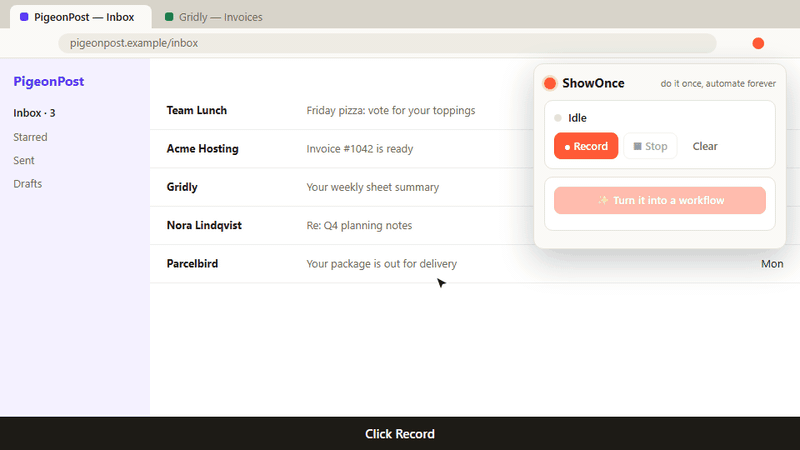
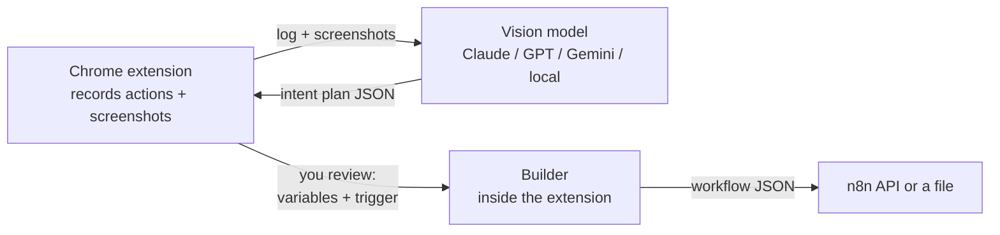

<div align="center">

# ShowOnce

### Do a task once in your browser. Get an n8n workflow that does it forever.

<!-- The extension popup with an example recording. A screen capture of a real task, ending in n8n, would be even better. -->


**No nodes to drag. No expressions to learn. Just show it.**

[Quickstart](#quickstart) · [How it works](#how-it-works) · [Choosing the AI](#choosing-the-ai) · [Privacy](#privacy) · [Roadmap](#roadmap)

</div>

---

Building automations is still a job for people who already know automation tools. Everyone else does the same boring browser task every day: copy an amount from an email, paste it into a sheet, send a message.

**ShowOnce watches you do it one time** and turns the recording into a real, editable [n8n](https://n8n.io) workflow. It doesn't replay your clicks. It understands what you were *trying to do* and uses proper API nodes (Gmail, Google Sheets, HTTP, Telegram…), so the result is fast and doesn't break when a website changes its layout.

```
 You, once                          ShowOnce                              n8n, forever
┌──────────────────────┐    ┌────────────────────────────┐    ┌──────────────────────────────┐
│ open Gmail           │    │ "search unread invoices,   │    │ ⏰ Weekdays 9:00              │
│ search "fatura"      │ ─► │  extract the amount,       │ ─► │ → Gmail: search               │
│ copy R$ 189,90       │    │  append a row,             │    │ → Code: extract amount        │
│ paste into Sheets    │    │  notify on Telegram"       │    │ → Sheets: append row          │
│ message on Telegram  │    │                            │    │ → Telegram: notify            │
└──────────────────────┘    └────────────────────────────┘    └──────────────────────────────┘
```

## Features

- 🎬 **Record by doing.** A Chrome extension captures clicks, typing, navigation and copy/paste, plus screenshots.
- 🧠 **Intent, not macros.** A vision model figures out the *task* and maps it to API nodes.
- 🎛️ **You stay in control.** Before anything is created, review the steps, choose which values change every run, and pick the trigger (manual, schedule, webhook, or new email).
- ⚡ **One click to n8n.** Creates the workflow through the n8n API, or download the JSON and import it.
- 🔌 **Bring your own model.** Claude (default), OpenAI, Gemini, any OpenAI-compatible API, or a local model via Ollama.
- 🔑 **Or no API key at all.** Let the AI assistant you already use do it over MCP, or paste the prompt into any chat AI.
- 🔒 **Private by design.** Runs in your browser. Passwords, card numbers and tokens are never recorded.
- 📦 **Nothing to run.** Everything happens inside the extension. No server, no `npm install`.

## Quickstart

You need **Chrome** (or any Chromium browser). That's all.

**1. Get the extension**

[Download the ZIP](https://github.com/subnautixx/showonce/archive/refs/heads/main.zip) and unzip it (or `git clone` this repo). Open `chrome://extensions`, turn on **Developer mode**, click **Load unpacked** and pick the `extension/` folder.

**2. Set up (once, in the popup)**

Click the ShowOnce icon. The **Set up** checklist opens by itself:

1. **Pick the AI** that reads your recording. No key? Choose *Any AI chat* and you copy a prompt into ChatGPT, Claude or Gemini. Have a key? Paste it; **Get a key** opens the right page.
2. **Connect n8n** (optional): type its address, click **Get an API key**, paste, **Connect**. No n8n yet? The popup offers n8n cloud or a one-line Docker command, and **Download JSON** works without any n8n.

**3. Show it once**

**● Record** → do your task → **■ Stop** → **✨ Turn it into a workflow**. Review, then **Create in n8n** or **Download JSON**.

## How it works



1. **Record.** The extension logs each action with the element's label and takes a screenshot right after it.
2. **Understand.** The model receives the action log and up to 20 screenshots and returns a *plan*: steps from a small, fixed vocabulary (`gmail.search`, `sheets.append`, `http.request`, `transform`, …), the values that look like variables, and a suggested trigger.
3. **Review.** You confirm what changes between runs and when it should run.
4. **Build.** A deterministic builder turns the plan into n8n nodes and connections. The model never writes raw n8n JSON, which keeps the output valid.

When something has no API, it becomes a clearly marked **manual step** with instructions instead of a fragile click-replay.

### Supported steps

| Step | n8n node |
|---|---|
| Search / send email | Gmail |
| Read / append rows | Google Sheets |
| Call any API | HTTP Request |
| Send a message | Telegram |
| Extract, clean, reshape data | Code |
| Anything else | Marked manual step + note |

Adding a step type is one function in [`extension/core/builder.js`](extension/core/builder.js) and one line in the prompt. PRs welcome!

## Choosing the AI

Pick it in the popup under **Set up**. You can change it any time.

| Option | Needs | Notes |
|---|---|---|
| Any AI chat | Nothing | You copy a prompt and paste the answer. No screenshots, so best for simpler tasks. |
| Claude | API key | Strong at reading UIs and producing valid structured output. |
| Gemini | API key | Good and usually cheaper. |
| OpenAI or compatible | API key | Change the address for any compatible API. |
| Ollama | Ollama running locally | Free and offline; less accurate on complex pages. Start it with `OLLAMA_ORIGINS=chrome-extension://*`. |
| Your AI assistant (MCP) | Node.js 20+ | Claude Code, Claude Desktop, Cursor… reads the recording, screenshots included. See below. |

## Your AI assistant, over MCP

The only mode that needs something outside the extension: a small helper your assistant starts by itself.

1. Add ShowOnce to the assistant. In Claude Code:

   ```bash
   claude mcp add --scope user showonce -- npx -y github:subnautixx/showonce mcp
   ```

   In other clients, add this to their MCP config:

   ```json
   { "mcpServers": { "showonce": { "command": "npx", "args": ["-y", "github:subnautixx/showonce", "mcp"] } } }
   ```

2. In the popup, pick **My AI assistant, over MCP** under Set up.
3. Record your task and click **✨ Turn it into a workflow**. The popup says it is waiting for your assistant.
4. Ask the assistant: *"turn my ShowOnce recording into a workflow"*.
5. Open the popup again: the plan is there to review.

## Privacy

- Nothing runs outside your browser, except the AI you pick and your own n8n.
- API keys stay in the extension's local storage on this computer. Each key is only sent to the service it belongs to.
- Password fields, card fields (`autocomplete="cc-*"`), one-time codes and fields named like `token`, `secret`, `cpf`, `cvv`… are replaced with `[REDACTED]` **in the page**, before anything is stored.
- Recordings stay in the extension's local storage until you clear them. Only the AI you choose sees them, and with Ollama nothing leaves your machine.
- Screenshots can still show what's on screen. Avoid recording pages with sensitive information, or use a local model.
- The MCP helper listens on `127.0.0.1` only and refuses requests from websites.

## Roadmap

- [ ] Launch GIF and more example recordings
- [ ] Chrome Web Store listing
- [ ] More step types: Slack, Notion, Airtable, WhatsApp, Discord
- [ ] Browser-runner node for steps without an API (Playwright)
- [ ] Record across desktop apps, not only the browser
- [ ] "Show it twice": learn variables by diffing two recordings
- [ ] Export to Make / Zapier / plain code
- [ ] Firefox support

## Development

```bash
npm test        # 16 tests, no dependencies
npm run demo    # helper server with a canned plan
npm start       # helper server with the provider from server/.env
```

Project layout:

```
extension/        Chrome extension (Manifest V3): recorder, popup, review UI
  core/           everything shared with the helper: no node: imports
    prompt.js       what the model is told
    plan.js         plan validation
    builder.js      plan → n8n workflow
    providers/      Claude, OpenAI, Gemini, Ollama
    n8n.js          connect to n8n and create workflows
server/           Optional zero-dependency Node helper (MCP mode)
  src/handoff.js    the recording waits for a plan from the assistant
  src/mcp.js        MCP server for AI assistants
  src/cli.js        `npx github:subnautixx/showonce [start|mcp|demo]`
```

## License

MIT. Not affiliated with n8n GmbH.
