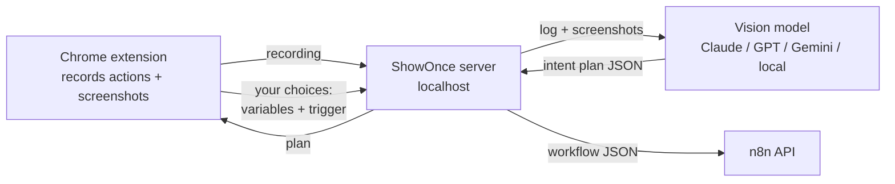

<div align="center">

# ShowOnce

### Do a task once in your browser. Get an n8n workflow that does it forever.

<!-- Replace with your launch GIF: 10s of doing the task by hand → the workflow appearing in n8n and running -->


**No nodes to drag. No expressions to learn. Just show it.**

[Quickstart](#quickstart) · [How it works](#how-it-works) · [No API key](#no-api-key) · [Privacy](#privacy) · [Roadmap](#roadmap)

</div>

---

Building automations is still a job for people who already know automation tools. Everyone else does the same boring browser task every day: copy an amount from an email, paste it into a sheet, send a message.

**ShowOnce watches you do it one time** and turns the recording into a real, editable [n8n](https://n8n.io) workflow. It doesn't replay your clicks. It understands what you were *trying to do* and uses proper API nodes (Gmail, Google Sheets, HTTP, Telegram…), so the result is fast and doesn't break when a website changes its layout.

```
 You, once                          ShowOnce                              n8n, forever
┌──────────────────────┐    ┌────────────────────────────┐    ┌──────────────────────────────┐
│ open Gmail           │    │ "search unread invoices,   │    │ ⏰ Weekdays 9:00              │
│ search "fatura"      │ ─► │  extract the amount,       │ ─► │ → Gmail: search               │
│ copy R$ 189,90       │    │  append a row,             │    │ → Code: extract amount        │
│ paste into Sheets    │    │  notify on Telegram"       │    │ → Sheets: append row          │
│ message on Telegram  │    │                            │    │ → Telegram: notify            │
└──────────────────────┘    └────────────────────────────┘    └──────────────────────────────┘
```

## Features

- 🎬 **Record by doing.** A Chrome extension captures clicks, typing, navigation and copy/paste, plus screenshots.
- 🧠 **Intent, not macros.** A vision model figures out the *task* and maps it to API nodes.
- 🎛️ **You stay in control.** Before anything is created, review the steps, choose which values change every run, and pick the trigger (manual, schedule, webhook, or new email).
- ⚡ **One click to n8n.** Creates the workflow through the n8n API, or download the JSON and import it.
- 🔌 **Bring your own model.** Claude (default), OpenAI, Gemini, any OpenAI-compatible API, or a local model via Ollama.
- 🔑 **Or no API key at all.** Let the AI assistant you already use do it over MCP, or paste the prompt into any chat AI.
- 🔒 **Private by design.** Runs on your machine. Passwords, card numbers and tokens are never recorded.
- 📦 **Zero dependencies.** The server is plain Node.js. No `npm install`.

## Quickstart

You need **Node.js 18+**, **Chrome** (or any Chromium browser) and an **n8n** instance (`npx n8n` or [n8n cloud](https://n8n.io)).

**1. Start the server**

```bash
git clone https://github.com/YOUR_USER/showonce.git
cd showonce/server
cp .env.example .env      # add your ANTHROPIC_API_KEY (or another provider)
npm start
```

No API key yet? `npm run demo` runs with a built-in example so you can see the whole flow. Don't want one at all? See [No API key](#no-api-key).

**2. Load the extension**

Open `chrome://extensions`, turn on **Developer mode**, click **Load unpacked** and pick the `extension/` folder.

**3. Show it once**

Click the ShowOnce icon → **● Record** → do your task → **■ Stop** → **✨ Turn it into a workflow**. Review, then **Create in n8n**.

> To create workflows directly, add `N8N_URL` and `N8N_API_KEY` (n8n → Settings → n8n API) to `server/.env`. Otherwise use **Download JSON** and import it in n8n.

## How it works



1. **Record.** The extension logs each action with the element's label and takes a screenshot right after it.
2. **Understand.** The model receives the action log and up to 20 screenshots and returns a *plan*: steps from a small, fixed vocabulary (`gmail.search`, `sheets.append`, `http.request`, `transform`, …), the values that look like variables, and a suggested trigger.
3. **Review.** You confirm what changes between runs and when it should run.
4. **Build.** A deterministic builder turns the plan into n8n nodes and connections. The model never writes raw n8n JSON, which keeps the output valid.

When something has no API, it becomes a clearly marked **manual step** with instructions instead of a fragile click-replay.

### Supported steps

| Step | n8n node |
|---|---|
| Search / send email | Gmail |
| Read / append rows | Google Sheets |
| Call any API | HTTP Request |
| Send a message | Telegram |
| Extract, clean, reshape data | Code |
| Anything else | Marked manual step + note |

Adding a step type is one function in [`server/src/builder.js`](server/src/builder.js) and one line in the prompt. PRs welcome!

## Choosing a model

Set `SHOWONCE_PROVIDER` in `server/.env`:

| Provider | Value | Notes |
|---|---|---|
| Anthropic Claude | `claude` | Default. Strong at reading UIs and producing valid structured output. |
| Google Gemini | `gemini` | Good and usually cheaper. |
| OpenAI / compatible | `openai` | Set `OPENAI_BASE_URL` for any compatible API. |
| Local | `ollama` | Free and fully offline; less accurate on complex pages today. |
| Your AI assistant | `mcp` | No key. The assistant you connect over MCP writes the plan; see below. |
| Demo | `mock` | Canned example, no key needed. |

Override the model with `SHOWONCE_MODEL`.

## No API key

Two ways to get a real plan without paying for a model API.

### Your AI assistant, over MCP

ShowOnce ships an MCP server, so an assistant you already use (Claude Code, Claude Desktop, Cursor, any MCP client) can watch the recording, screenshots included.

1. Connect it. In Claude Code, open this folder: the bundled [`.mcp.json`](.mcp.json) offers the `showonce` connector. To have it in every project:

   ```bash
   claude mcp add --scope user showonce -- node /absolute/path/to/showonce/server/src/mcp.js
   ```

   In other clients, add this to their MCP config:

   ```json
   { "mcpServers": { "showonce": { "command": "node", "args": ["/absolute/path/to/showonce/server/src/mcp.js"] } } }
   ```

2. Record your task and click **✨ Turn it into a workflow**. The popup says it is waiting for your assistant.
3. Ask the assistant: *"turn my ShowOnce recording into a workflow"*.
4. Open the popup again: the plan is there to review, then **Create in n8n** or **Download JSON** as usual.

The connector starts the ShowOnce server by itself, so you don't need `npm start`. If a server is already running on the port, it must use `SHOWONCE_PROVIDER=mcp`.

### Any chat AI, by copy and paste

Works with any provider setting, including `npm run demo`.

1. Record your task, then open **No API key? Use any AI chat** in the popup.
2. **Copy prompt** (or **Save as .md**) and send it to ChatGPT, Claude, Gemini or whatever you use.
3. Paste the answer back and click **Use this plan**.

This path sends the action log only, without screenshots, so the plan can be less accurate on complex pages.

## Privacy

- The server listens on `127.0.0.1` only and refuses requests from websites (only the extension can call it).
- Password fields, card fields (`autocomplete="cc-*"`), one-time codes and fields named like `token`, `secret`, `cpf`, `cvv`… are replaced with `[REDACTED]` **in the browser**, before anything leaves the page.
- Recordings stay in the extension's local storage until you clear them. Only the model provider you choose sees them, and with `ollama` nothing leaves your machine.
- Screenshots can still show what's on screen. Avoid recording pages with sensitive information, or use a local model.

## Roadmap

- [ ] Launch GIF and more example recordings
- [ ] More step types: Slack, Notion, Airtable, WhatsApp, Discord
- [ ] Browser-runner node for steps without an API (Playwright)
- [ ] Record across desktop apps, not only the browser
- [ ] "Show it twice": learn variables by diffing two recordings
- [ ] Export to Make / Zapier / plain code
- [ ] Firefox support

## Development

```bash
cd server
npm test        # 15 tests, no dependencies
npm run demo    # server with the mock model
```

Project layout:

```
extension/   Chrome extension (Manifest V3): recorder, popup, review UI
server/      Zero-dependency Node server
  src/prompt.js     what the model is told
  src/plan.js       plan validation
  src/builder.js    plan → n8n workflow
  src/providers/    Claude, OpenAI, Gemini, Ollama, mock
  src/handoff.js    no-key mode: the recording waits for a plan from outside
  src/mcp.js        MCP server for AI assistants
```

## License

MIT. Not affiliated with n8n GmbH.
